# Clainova visual concept review

Ten original still mockups compare a desktop organiser screen with a speaker’s mobile invitation. Sample dates, phone numbers, names and alternate brand marks are for design review. The motion descriptions are proposals.

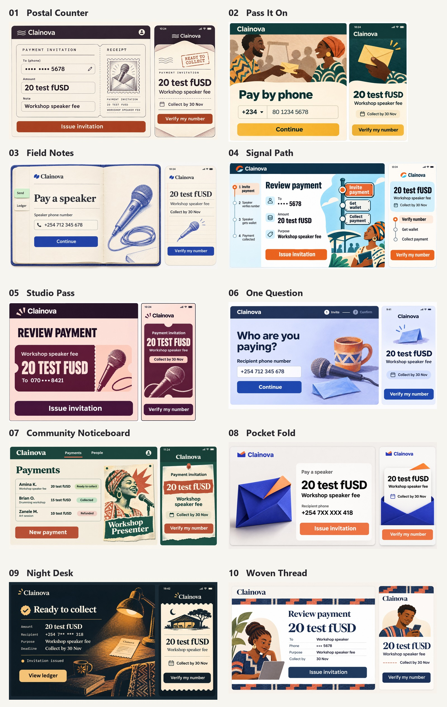

## Recommended combination

Use **02 Pass It On** for the visual identity, **06 One Question** for forms and **01 Postal Counter** for receipts. Carry one yellow envelope from the organiser’s send screen to the speaker’s invitation. Scale the illustration down after the invitation opens. Keep the amount, deadline and next action together on small phones. Use the existing Clainova wordmark as the starting point during refinement.

## What the product needs from the redesign

The organiser’s first action is entering a phone number. The current app already stages recipient, amount and review. Preserve the editable recipient and the live slip. At review, show the complete number to the organiser who entered it so they can check every digit. Use the masked form on issued receipts and in the ledger.

The speaker arrives from an SMS. Lead with the workshop note when supplied, the amount in test fUSD, the collection deadline and the next step. Use the organiser’s identifying label only when the service has a reliable source. Include a short explanation that the speaker can create a wallet during collection. In the verification step, say which masked number will receive the code. Carry the invitation forward while they save their encrypted backup and approve collection.

Funding, SMS provider acceptance and collection are distinct events. Give each a truthful status. When delivery fails after funding, offer the existing redelivery path. At expiry, show who can recover the funds. Show “Refunded” after the refund succeeds.

## Ten directions

### 01 · Postal Counter

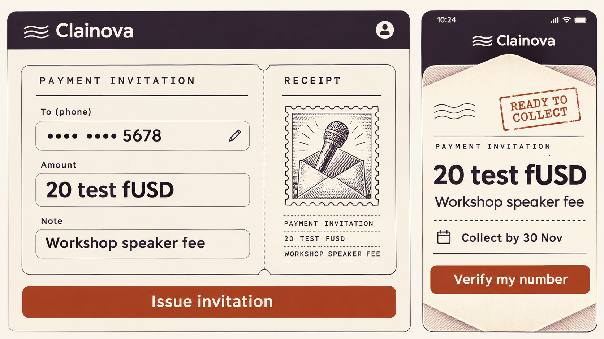

A detachable receipt and engraved microphone stamp give the organiser and speaker matching records. After confirmed collection, the status stamp settles once over 220 ms.

**Design judgement.** The existing slip makes this the shortest route to implementation. Keep the primary amount in one place per screen.

### 02 · Pass It On

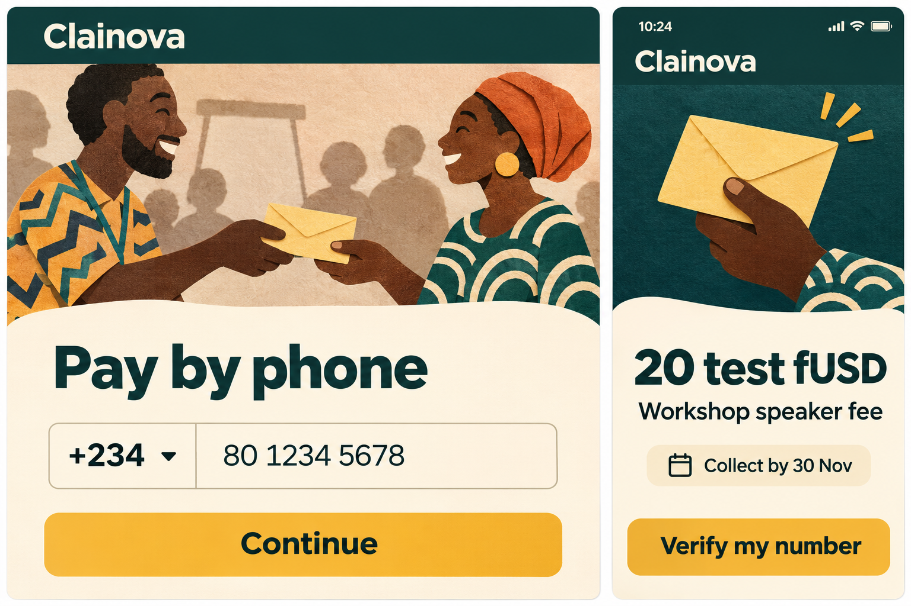

A golden envelope passes between workshop participants. On the invitation, the speaker sees the receiving hand. When a valid invitation opens, its folded edge lifts once over 220 ms. The amount and action are visible immediately.

**Design judgement.** Strongest first impression. Shorten the phone artwork, add a persistent phone field label and keep the event note close to the amount.

### 03 · Field Notes

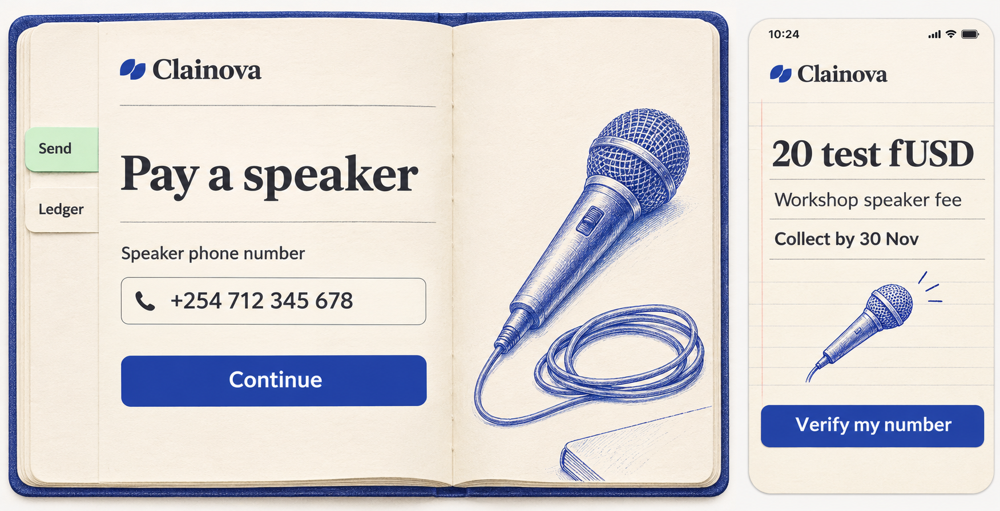

A notebook spread puts the task on one page and a cobalt microphone sketch on the other. After a valid phone number, the active tab advances to the amount page in 180 ms.

**Design judgement.** A good fit for an organiser returning to a working notebook. The phone version needs a compact illustration when the keyboard opens.

### 04 · Signal Path

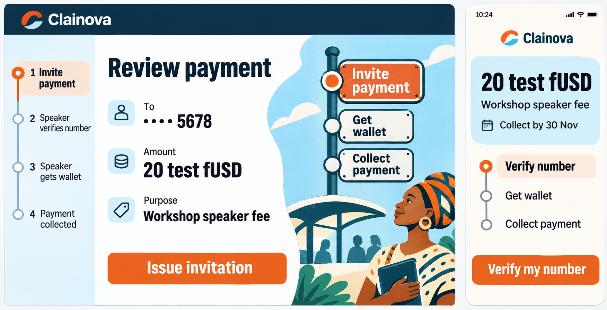

A route with named stops helps first-time speakers anticipate verification, wallet setup and collection. When a step succeeds, the next marker fills in 180 ms and its text becomes current.

**Design judgement.** Borrow the phone stepper. The desktop rendering repeats the sequence in both the sidebar and the illustration.

### 05 · Studio Pass

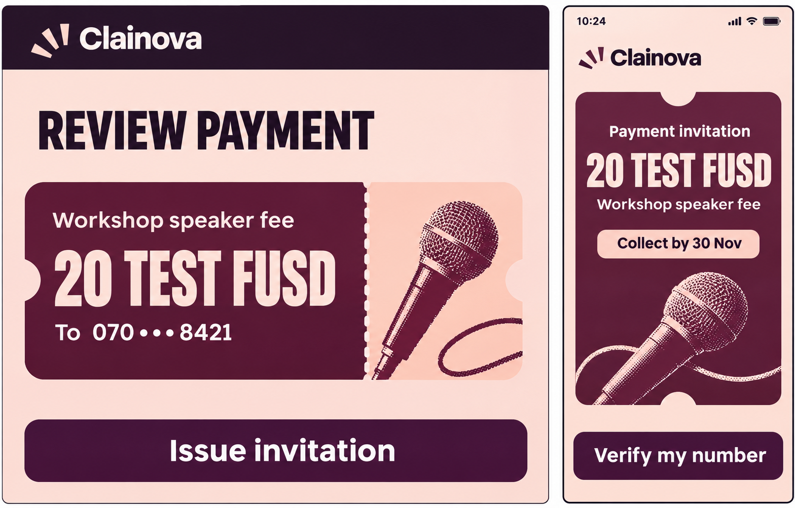

The fee appears on a detachable event pass with a screenprinted microphone. Once funding is confirmed, the stub separates a few pixels and settles into the invitation receipt in 220 ms.

**Design judgement.** Strong for events. Use ordinary mixed-case type for 20 test fUSD and make the payment purpose explicit.

### 06 · One Question

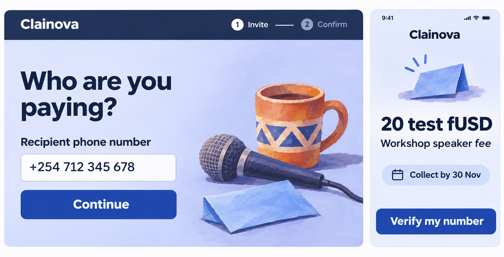

One question, a visible field label and a large Continue button put the next decision first. On a valid submission, the next field fades in over 150 ms and focus moves to its heading.

**Design judgement.** Best interaction model for phone verification and wallet backup. Keep previously entered details available on review.

### 07 · Community Noticeboard

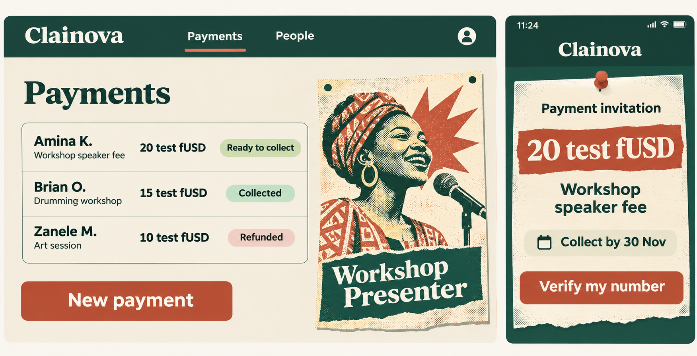

A noticeboard pairs a ledger with a screenprinted workshop poster. When the ledger receives a new status, its row updates in place with a brief 180 ms highlight.

**Design judgement.** Best for a returning organiser. Use the masked number and optional note the service already stores. The illustrated People tab and sample names are mockup artifacts.

### 08 · Pocket Fold

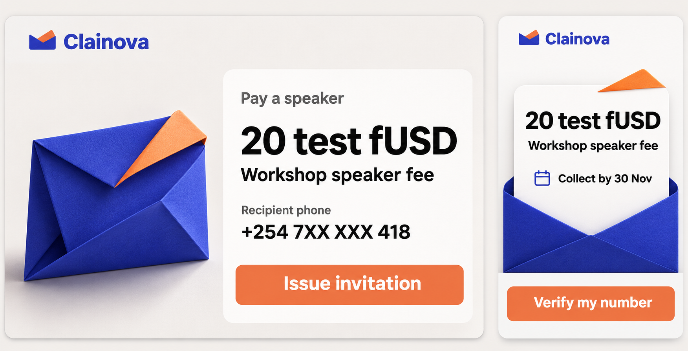

An ultramarine paper pocket holds the invitation and keeps the amount prominent. When the private invitation loads, the receipt rises 8 px from the pocket over 220 ms.

**Design judgement.** A strong single-object identity. Give the amount and action their own space at 375 px and darken the orange button for legible text.

### 09 · Night Desk

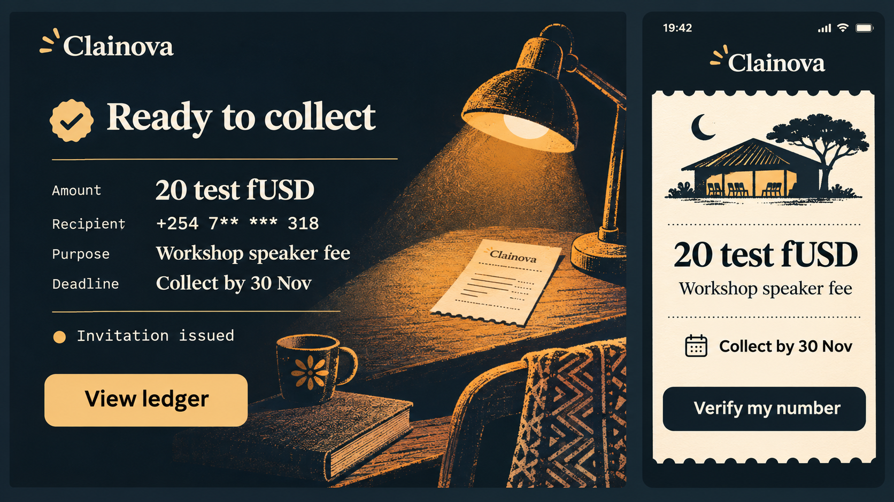

A warm desk lamp lights an issued receipt. The mobile slip remains light for reading. When issuance is confirmed, the lamp brightens once over 200 ms beside the status text.

**Design judgement.** Best dark direction. Reserve the completion check for a collected payment and label an outstanding invitation as ready to collect.

### 10 · Woven Thread

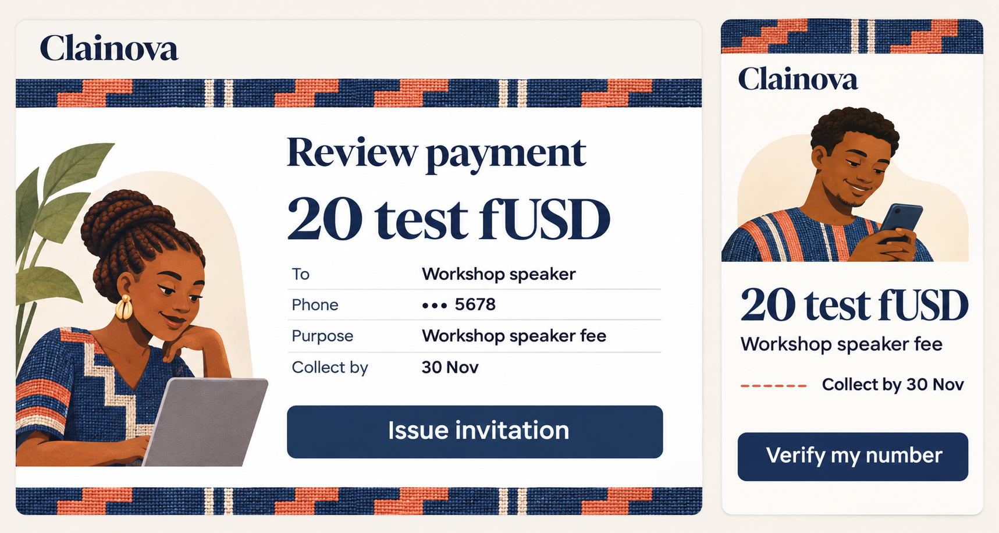

Separate portraits of the organiser and speaker share an indigo woven border. After phone verification succeeds, a short stitch extends to the wallet step over 180 ms.

**Design judgement.** Best editorial alternative. Keep the weave at the edges so text, especially the deadline, stays easy to scan.

## Reference screenshots

Wise puts the amounts in a high-contrast panel and distinguishes the sender and recipient. For Clainova, put the test unit immediately beside the amount. [Wise transfer page](https://wise.com/gb/send-money/)

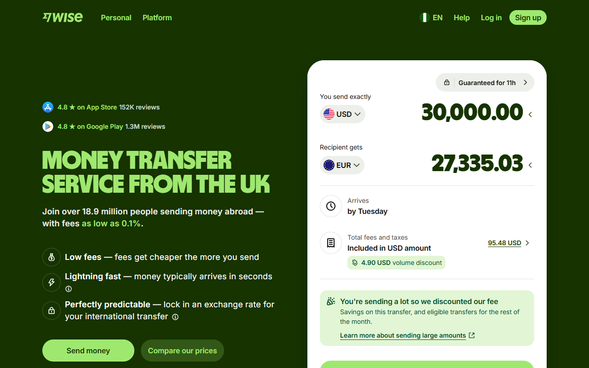

The NHS review page aligns each editable value with its own Change link. Give the organiser that same opportunity to correct the number before funding. [NHS check answers example](https://service-manual.nhs.uk/design-example/patterns/check-answers/example)

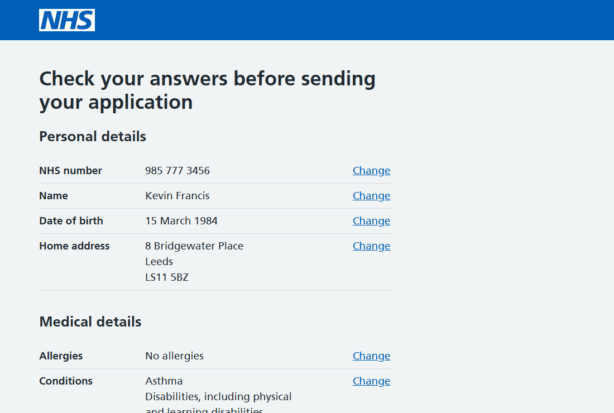

The GOV.UK confirmation panel names the completed action, with next steps immediately below. Apply this structure to invitation issuance, collection and refunds using distinct status text. [GOV.UK confirmation example](https://design-system.service.gov.uk/patterns/confirmation-pages/default/)

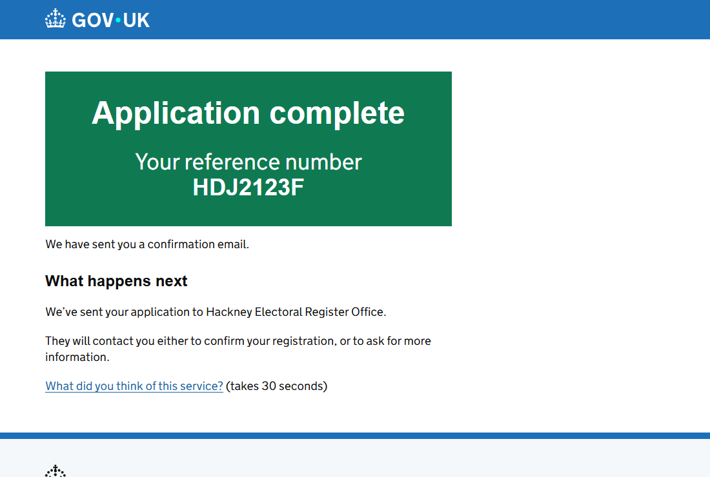

## Proposed implementation after selection

1. Apply the selected type, colour, illustrations and spacing to the existing counter, private invitation and shared receipt in `web/index.html`, `web/styles.css`, `web/view.js` and `web/app.js`. Review the first screen on desktop and phone with realistic notes and long amounts.
2. Carry the design through review, issuance, incorrect or expired codes, wallet creation or restore, backup, collection, receipt, next transfer, empty ledger, delivery failure and refund. Preserve the distinction between local rehearsal and Diana testnet. Give a pending transaction a persistent text status while waiting for confirmation.
3. Attach the selected transitions to actual state changes. Move keyboard focus to each new step heading or the first invalid field. Announce status updates. With reduced motion, show the same end state immediately. The user can act as soon as each control is available.
4. Exercise the whole local send and collect flow at 375 px and 1440 px, including keyboard-only use, overflow, errors and repeat visits. Run the build, unit, contract and browser suites. Capture both widths and record the defining motion.
5. For release, the repository still calls for a funded Diana invitation, collection from a fresh device, follow-on transfer, handset SMS evidence and the two QCAI reports. Track those separately from visual sign-off.

## Generation notes

The original concepts were generated with the built-in ImageGen tool. [Read the exact prompts](prompts.md).
